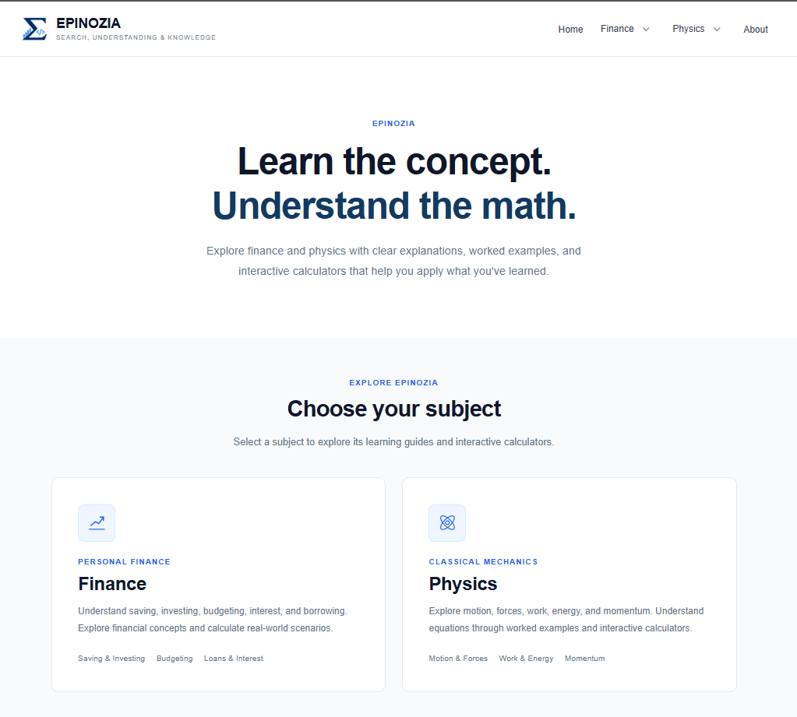
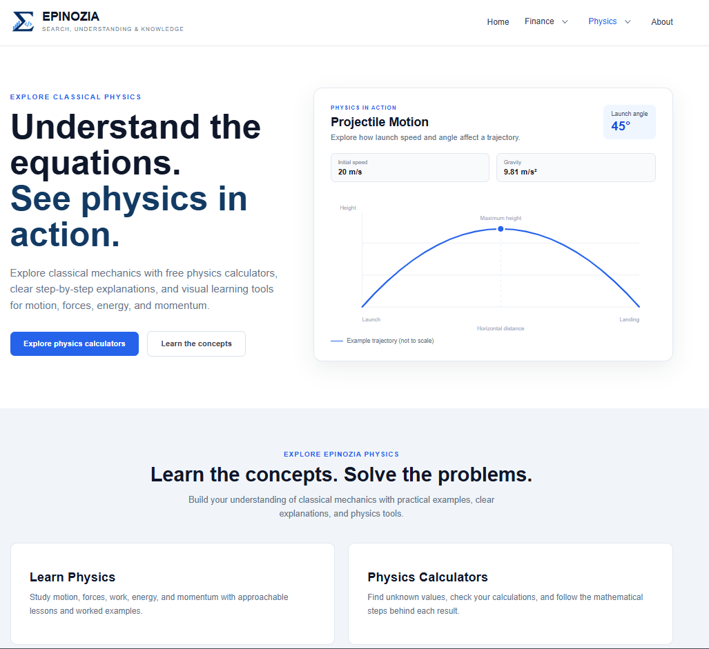
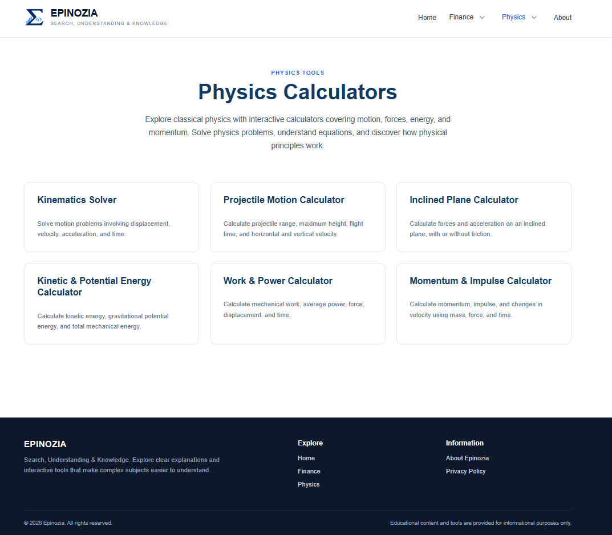
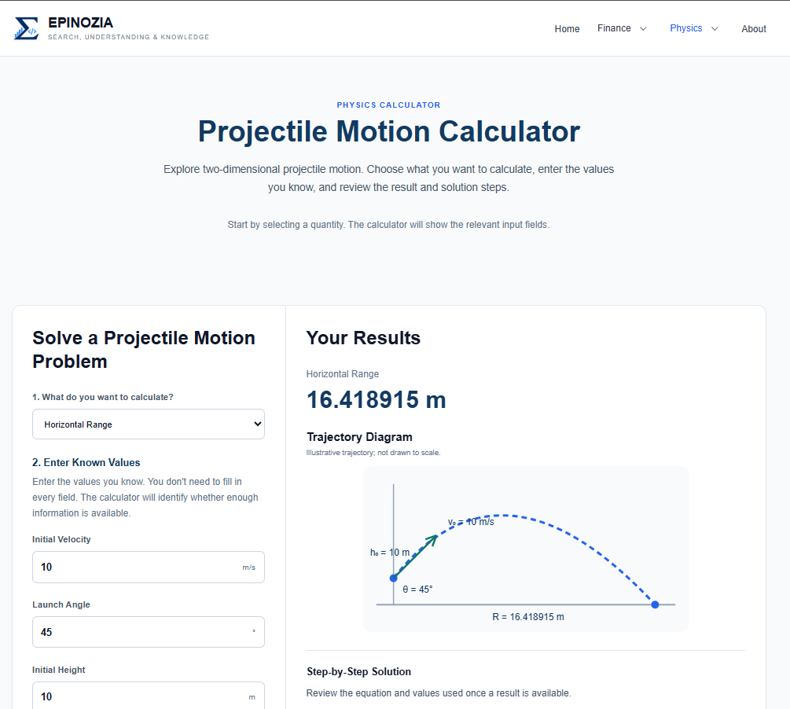

# Epinozia

**Educational Web Platform | Finance & Physics**

Epinozia is an educational website I developed to make finance and physics concepts easier to understand through interactive calculators and practical learning resources.

## Features

- Interactive finance and physics calculators
- Step-by-step explanations and worked examples
- Educational articles covering key concepts
- Responsive design for desktop and mobile devices

## Technologies

HTML, CSS, JavaScript, PHP

## Live Website

[Visit Epinozia](https://epinozia.com)

## Screenshots

### Homepage

### Physics

### Physics Calculators

### Finance Learning

### Projectile Motion Calculator

